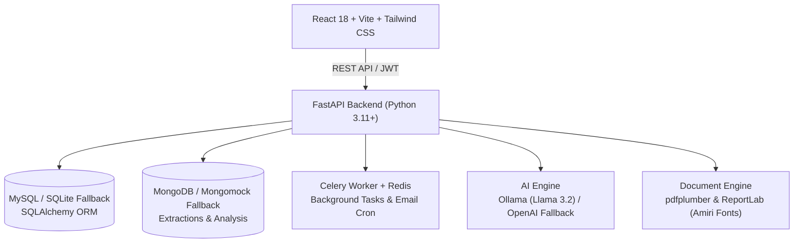

# Career Compass 🚀
> **AI-Powered Career Guidance, Resume Intelligence & Technical Interview Platform**  
> *Aligned with Technical Specification & Architecture Reference Guide v1.1*

[](https://fastapi.tiangolo.com/)
[](https://react.dev/)
[-black?style=flat)](https://ollama.ai/)
[](https://docs.celeryq.dev/)
[](https://docs.pytest.org/)

Career Compass is a full-stack, AI-driven career guidance and resume intelligence platform. Unlike traditional keyword-matching career tools, Career Compass integrates local Generative AI models (via **OpenAI** when configured, with local **Ollama** fallback) to deeply analyze candidate resumes in Arabic and English, benchmark candidate skills against industry standards, generate personalized 3-month skill roadmaps, and conduct interactive technical mock interviews.

---

## ✨ Key Features & Capabilities

### 1. 📄 AI Resume Intelligence & LinkedIn Import
- **Multi-lingual PDF Parsing:** Extracts complex multi-column resumes in both English and Arabic using `pdfplumber` and local LLMs.
- **LinkedIn Profile Import:** Automatically detects exported LinkedIn PDF profiles and accurately extracts the **"Top Skills"** section and structured experience.
- **Manual Profile Fallback:** Full manual profile entry for users starting without a resume.

### 2. 🎯 Dynamic Recommendation Engine & 3-Month Roadmap
- **Weighted Skill Gap Analysis:** Algorithmic matching against industry roles using weighted categories (Essential: 1.0, Important: 0.6, Bonus: 0.3).
- **Interactive Roadmap Checklist:** Structured 3-month learning roadmap with milestones, interactive skill progress tracking, and curated learning courses.
- **Career DNA:** Multi-axis technical evaluation visualization (Programming, Data Handling, System Design, Communication, Problem Solving).

### 3. 🤖 Interactive Mock Interview Simulator & Voice AI
- **Hiring Manager AI Persona:** Dynamically interviews candidates on their specific target role and identified skill deficiencies.
- **Voice & Audio Interviews:** Real-time microphone audio recording (`MediaRecorder`), transcription (OpenAI Whisper), and speech metrics (Clarity, Pace/WPM, Vocal Confidence).
- **Structured 10-Point Scoring:** Evaluates completed sessions out of 10, categorizing Technical and Communication proficiency, identifying specific mistakes, and providing model answers.

### 4. 🔍 ATS Audit & In-Browser ATS Resume Builder
- **ATS Readability Score:** Comprehensive automated audit identifying formatting risks, section hierarchy issues, and missing industry keywords.
- **Full ATS Resume Builder & Exporter:** Interactive modal to refine profile details, optimize bullets via AI, and export an ATS-compliant resume PDF.
- **AI Cover Letter Generator:** One-click tailored cover letters for specific job descriptions.

### 5. 💼 Example Job Matching
- **Smart Synonym Matching:** Algorithmic candidate matching against active tech vacancies (Asal Technologies, Exalt, Harri, Foothill, Souktel, Progineer, Paltel, Canonical, Spotify, etc.).
- **Platform Listings:** Matches skills against active job postings from approved recruiters on Career Compass. This does not search external job boards.

### 6. 🏆 Gamification, Peer Benchmark & Arabic PDF Export
- **Gamification Badges:** Badges awarded based on milestones (e.g., Profile Pioneer, Roadmap Master).
- **Peer Cohort Benchmarking:** Anonymous percentile comparison against peer cohort runs.
- **Bidirectional Arabic PDF Export:** Branded, downloadable PDF reports with Arabic RTL support powered by `ReportLab` and bundled `Amiri` typography.
- **Public Report Sharing:** Secure tokenized links for public, unauthenticated viewing with revocation controls.

### 7. 🏢 B2B HR & Recruiter Portal (Phase 3)
- **Corporate Job Specifications:** Dedicated corporate dashboard for employers to post, update, and manage vacancies.
- **AI Candidate Discovery & Ranking:** Automated candidate talent pool matching against job requirements, ranking candidates by match percentage and ATS score.
- **Candidate Privacy:** Candidates must opt in from Settings before recruiters can discover their details; consent can be withdrawn. Recruiter access requires manual approval by an administrator.
- **Recruitment Pipeline Management:** Interactive candidate tracking stages (Discovered, Shortlisted, Contacted, Interviewed, Offered, Rejected).
- **Candidate Profile Deep-Dive:** Direct view of verified skills, work history, projects, and AI fit evaluation.

### 8. 💎 Monetization & Payment Gateways (Under Development)
- **Tiered Subscriptions:** Freemium ($0), Unlimited AI Pro ($19/mo or $180/yr), and Recruiter & Enterprise ($79/mo).
- **Experimental checkout:** Subscription and payment code is under development and is not launched or ready for real payments.
- **Subscription Lifecycle:** Plan feature matrix, limits enforcement, and 1-click auto-renew cancellation.

### 9. 🧭 Chrome Browser Extension (LinkedIn Job Matcher)
- **Manifest V3 Extension:** Standalone extension in `chrome-extension/` with glassmorphic UI.
- **Instant LinkedIn Compatibility Audit:** Scrapes active LinkedIn job details and runs immediate skill gap analysis against user profile.
- **AI Cover Letter Generator Snippet:** 1-click tailored intro paragraph tailored to the viewed company and role.

### 10. 📱 Cross-Platform Mobile Companion (React Native / Expo)
- **Mobile Mock Interviews:** Sign in and practice with text or recorded voice using your latest analysis. Without an OpenAI key, speech is transcribed locally using Whisper and interview responses use Ollama.
- **3-Month Roadmap Checklist:** View and update the latest roadmap while connected to the backend in `mobile/`.

### 11. 🧠 Domain Fine-Tuned LLM Pipeline & Regional Taxonomy
- **Regional Tech Ecosystem:** Taxonomies for Palestinian and MENA tech employers, local university recognition, and salary benchmarks.
- **Fine-Tuning Dataset Generator:** Automated script (`prepare_finetuning_dataset.py`) producing ChatML/JSONL training sets for Llama-3 domain adaptation.

---

## 🛠️ Architecture & Tech Stack



| Layer | Technologies |
| :--- | :--- |
| **Frontend (Web)** | React 18, Vite, React Router v6, Tailwind CSS, Recharts, Axios, Lucide Icons |
| **Browser Extension** | Chrome Extension Manifest V3 (`chrome-extension/`), LinkedIn DOM Matcher & SPA Observer |
| **Mobile Companion** | React Native / Expo (`mobile/`), text interviews and connected roadmap |
| **Backend API** | FastAPI, Python 3.11+, Pydantic v2, Uvicorn, Sliding-Window Rate Limiter, OWASP Security Headers |
| **Relational DB** | MySQL 8.0 (Production with auto-migration) & SQLite WAL Fallback (Local Dev/Testing) |
| **Document DB** | MongoDB 7.0 (Indexed Collections) with Mongomock Fallback |
| **Task Queue** | Celery 5.3+, Redis 7.0+ (Async PDF Extraction Worker & Weekly Progress Email Cron) |
| **AI / LLMs** | Ollama (`career-model` / `llama3.2`), OpenAI (`gpt-3.5-turbo`, Whisper Audio Transcription) |
| **PDF Processing**| `pdfplumber` (multi-column parsing), `reportlab` (bilingual RTL Arabic PDF career & ATS reports) |
| **Testing** | Pytest, FastAPI TestClient, Mongomock, Unittest.mock (**131 automated tests — 100% passing**) |

---

## 📂 Project Structure

```text
career-compass/
├── backend/
│   ├── alembic/                  # Database schema migrations (Phase 1–3)
│   ├── app/
│   │   ├── api/routes/           # REST API routers (auth, cv, analyze, interview, recruiter, subscriptions, extension, ...)
│   │   ├── assets/fonts/         # Bundled Amiri Arabic fonts for RTL PDF generation
│   │   ├── core/                 # Config, MySQL/SQLite pool, MongoDB indexes, JWT security, Rate Limiter
│   │   ├── models/               # SQLAlchemy relational models (User, Job, Skill, Question, Course)
│   │   ├── schemas/              # Strict Pydantic v2 request/response schemas & validators
│   │   ├── seed/                 # Reference skills (117), jobs (30), assessment questions & courses
│   │   ├── services/             # Recommendation engine, ATS builder, Interview AI, Recruiter B2B, Stripe Billing, Regional Taxonomy
│   │   └── worker/               # Celery background tasks & scheduled weekly beat jobs
│   ├── scripts/                  # Fine-tuning dataset generator (ChatML / JSONL)
│   └── tests/                    # automated backend test suites
├── frontend/
│   └── src/
│       ├── api/                  # Axios client & typed API endpoint wrappers
│       ├── components/           # Layout, ATS Resume Builder modal, Live Job Matching, Charts & UI primitives
│       ├── context/              # AuthContext, AnalysisContext, ToastContext
│       └── pages/                # Dashboard, Analysis, Mock Interview, Recruiter Portal (B2B), Pricing Plans
├── chrome-extension/             # Manifest V3 LinkedIn Job Matcher extension
├── mobile/                       # React Native (Expo) companion app
├── .github/workflows/ci.yml      # CI pipeline (backend pytest, frontend build/E2E, extension lint)
├── .env.example                  # Root production environment template (required secrets & CORS)
├── docker-compose.yml            # Local development container stack (bound to 127.0.0.1)
├── docker-compose.prod.yml       # Production stack (Nginx, Frontend, Backend, Celery, MySQL, Mongo, Redis, Ollama)
├── docker-compose.https.yml      # Production TLS override mounting nginx-https.conf & certbot/etc
├── nginx.conf                    # HTTP reverse proxy with OWASP security headers, CSP & rate limits
├── nginx-https.conf              # HTTPS reverse proxy with TLS 1.2/1.3, HSTS, Host validation & rate limits
└── start.ps1                     # One-click local startup script for Windows PowerShell (127.0.0.1 default; -Lan optional)
```

---

## 🚀 Quick Start (Local Development)

### Prerequisites
- **Node.js** (v18+) & **npm**
- **Python** (3.11+)
- **Ollama** installed locally (optional, fallback heuristics included)

### Option A: One-Click Startup (Windows PowerShell)
Simply run the included `start.ps1` script from the repository root:
```powershell
.\start.ps1
```
This automatically initiates the Ollama AI model (`llama3.2` by default, override via `$env:OLLAMA_MODEL`), starts the FastAPI backend bound to `127.0.0.1` (with SQLite and Mongomock fallbacks enabled for zero-dependency local runs; pass `-Lan` to bind `0.0.0.0`), launches the Vite frontend server, and opens your browser at `http://localhost:5173`.

---

### Option B: Manual Step-by-Step Setup

#### 1. Setup Backend
```bash
cd backend
python -m venv myenv

# Windows:
.\myenv\Scripts\activate
# Linux/macOS:
source myenv/bin/activate

pip install -r requirements.txt
```

Run the backend server (uses local SQLite & Mongomock fallback if MySQL/Mongo are offline):
```bash
# Windows PowerShell:
$env:USE_SQLITE_FALLBACK="1"; $env:USE_MONGOMOCK="1"; python -m uvicorn app.main:app --reload --port 8000

# Linux / macOS:
USE_SQLITE_FALLBACK=1 USE_MONGOMOCK=1 python -m uvicorn app.main:app --reload --port 8000
```
Backend API will be running at: `http://localhost:8000` (Interactive Docs: `http://localhost:8000/docs`)

#### 2. Setup Frontend
In a new terminal:
```bash
cd frontend
npm install
npm run dev
```
Frontend will be running at: `http://localhost:5173`

#### 3. Run Celery Worker (Optional - for background jobs)
```bash
cd backend
celery -A app.worker.celery_app worker --loglevel=info
```

---

## 🐳 Production Deployment (Docker Compose)

Recruiters request access through Companies; the platform owner reviews each company there. Select an approved company before opening its recruiter portal. As a server-side fallback, `docker compose -f docker-compose.prod.yml exec backend python -m scripts.recruiter_approval EMAIL approve` works when the account owns exactly one company; use `revoke` to suspend it.

For the initial owner, run `python -m scripts.bootstrap_platform_owner EMAIL` on the server with an existing account. Before upgrading an existing deployment, stop application writes and back up both SQL and MongoDB. Run `python -m scripts.migrate_recruiter_companies` for a dry run, inspect any errors, then run it with `--apply`. Legacy companies start pending review; approvals and candidate consent records remain intact. The migration is repeatable, but requires the application to remain stopped until it finishes. Confirm the migration and company approvals in an isolated environment before deploying.

The HTTPS override uses a Let's Encrypt certificate named `career-compass` in `certbot/etc` and the challenge webroot in `certbot/www`. Before deploying, copy `.env.example` to `.env` in the repository root and set strong values for `JWT_SECRET_KEY`, `MYSQL_ROOT_PASSWORD`, `MYSQL_PASSWORD`, `MONGO_INITDB_ROOT_USERNAME`, `MONGO_INITDB_ROOT_PASSWORD`, `REDIS_PASSWORD`, `CORS_ORIGINS`, `FRONTEND_BASE_URL`, and `TRUSTED_PROXY_IPS` (`docker-compose.prod.yml` fails closed if required secrets or CORS/frontend URLs are missing). Add your production domain or server IP to `server_name` in `nginx-https.conf` (defaulting to `localhost 127.0.0.1` to prevent Host-header open redirects). Start the HTTP configuration first only if needed to issue an initial certificate, then run Compose with both `-f docker-compose.prod.yml -f docker-compose.https.yml` and set `FRONTEND_BASE_URL` and `CORS_ORIGINS` to your `https://` URL. Schedule `backend/scripts/renew_https_ip.sh` at least twice daily: IP certificates have a short lifetime and the script reloads Nginx after renewal. Keep `certbot/etc` private and back it up securely.

The repository provides production-ready Docker Compose configurations (`docker-compose.prod.yml` + `docker-compose.https.yml`):

```bash
# 1. Configure required production secrets & origins in root .env
cp .env.example .env

# 2. Build and launch all services with HTTPS enabled
docker compose -f docker-compose.prod.yml -f docker-compose.https.yml up -d --build

# 3. Apply relational database migrations, pull local LLM, and seed initial catalogue data
docker compose -f docker-compose.prod.yml exec backend alembic upgrade head
docker compose -f docker-compose.prod.yml exec ollama ollama pull llama3.2
docker compose -f docker-compose.prod.yml exec backend python -c "from app.seed.seed_runner import run_seed; run_seed()"
```

---

## 📡 API Endpoints Overview

| Category | Method | Endpoint | Description |
| :--- | :--- | :--- | :--- |
| **Auth** | `POST` | `/register`, `/login` | Signup, login with JWT bearer tokens |
| **Auth** | `POST` | `/forgot-password`, `/reset-password` | Stateless password recovery via email |
| **Profile**| `GET`, `PUT` | `/profile` | Profile metadata, career goals & updates |
| **Profile**| `GET`, `DELETE`| `/profile/badges`, `/profile` | Earned achievement badges & account removal |
| **Settings**| `PUT` | `/settings/password`, `/benchmark-opt-in`, `/notifications` | Account security and preference toggles |
| **CV** | `POST` | `/upload-cv`, `/extract`, `/extract/async` | Synchronous and Celery asynchronous PDF extraction |
| **CV** | `POST` | `/extract/manual`, `/extract/confirm` | Manual profile specification and confirmation |
| **CV** | `GET`, `POST`| `/extract/{id}/ats-score`, `/cover-letter` | ATS readability audit & tailored AI cover letters |
| **CV Builder**| `POST` | `/extract/{id}/ats-builder/optimize`, `/export-ats-pdf` | AI resume builder & ATS-compliant PDF generation |
| **Assessment**| `GET`, `POST` | `/assessment` | Role-based technical quiz and proficiency scoring |
| **Analysis**| `POST` | `/analyze` | Recommendation engine & 3-month roadmap generation |
| **History**| `GET` | `/history`, `/history/{id}`, `/history/compare` | Past runs, side-by-side gap analysis |
| **Export** | `GET` | `/history/{id}/export/pdf` | Branded RTL Arabic & English PDF career report |
| **Roadmap**| `PATCH`| `/history/{id}/roadmap` | Interactive checklist milestone completion |
| **Shared** | `POST`, `GET`| `/history/{id}/share`, `/shared/{token}` | Public tokenized analysis report view |
| **Jobs** | `GET` | `/jobs/matched` | Active market vacancy matching with smart synonyms |
| **Interview**| `POST`| `/interview/start`, `/interview/chat` | Interactive AI technical mock interview session |
| **Interview**| `POST`| `/interview/{id}/voice`, `/interview/{id}/evaluate` | Whisper voice simulation & 10-point scoring |
| **Recruiter (B2B)**| `POST`, `GET`, `PUT`, `DELETE` | `/recruiter/jobs`, `/recruiter/jobs/{id}` | Corporate job postings & vacancy management |
| **Recruiter (B2B)**| `GET` | `/recruiter/jobs/{id}/candidates` | AI-driven candidate discovery & match ranking |
| **Recruiter (B2B)**| `POST`| `/recruiter/jobs/{id}/candidates/{cand_id}/status` | Update candidate recruitment pipeline stage |
| **Recruiter (B2B)**| `GET` | `/recruiter/candidates/{cand_id}/profile` | Candidate verified profile, projects & ATS score (RBAC protected) |
| **Recruiter (B2B)**| `POST`| `/recruiter/switch-role` | Upgrade account role to B2B Recruiter mode |
| **Monetization** | `GET` | `/subscriptions/plans`, `/subscriptions/current` | Pricing tiers (Free, Pro, Enterprise) & status |
| **Monetization** | `POST`| `/subscriptions/checkout-session`, `/cancel`, `/webhook` | Experimental; payment and subscriptions are not launched |
| **Extension** | `POST`| `/extension/match-job` | Real-time LinkedIn job text compatibility matcher |

---

## 🧪 Automated Testing & Test Suite (131/131 Tests Passing)

Career Compass comes with a comprehensive, enterprise-grade test suite covering every core capability, service, API endpoint, edge case, and multi-tenant security boundary:

```bash
# Run the full test suite with verbose reporting:
python -m pytest backend/tests/ -v
```

### Test Coverage Highlights:
- **Phase 3 B2B Recruiter Portal & Pipeline (`test_phase3_b2b_and_monetization.py`, `test_phase3_edge_cases_and_isolation.py`):** Multi-tenant job posting CRUD, newest-CV candidate ranking algorithm, pipeline status transitions across all 6 stages, and RBAC-protected deep-dive profile previews.
- **Monetization & Billing Gateways (`test_monetization_deep.py`, `test_phase3_advanced_expansion.py`):** Freemium/Pro/Enterprise plans configuration, 20% annual discount calculations, Stripe checkout sessions, open-redirect protection, sandbox instant activation, automated role assignment, subscription cancellation, and webhook handling.
- **Chrome Extension Matcher (`test_extension_api_deep.py`):** Real-time HTML and raw text job parsing, pre-compiled regex skill overlap (including symbol skills like `C++` and `C#`), salary benchmark alignment, and fallback modes.
- **Regional Market Intelligence & Fine-Tuning (`test_regional_taxonomy_deep.py`, `prepare_finetuning_dataset.py`):** MENA tech salary percentile validations, bilingual role normalization, university/tech-hub recognition, ChatML JSONL dataset generation.
- **Voice AI & Mock Interview Evaluation (`test_interview_service_and_scoring.py`, `test_phase3_advanced_expansion.py`):** Speech rate (WPM) calculations, filler words detection (Arabic/English), 10-point scoring rubrics, and model answer generation.
- **ATS Audit & Resume Builder (`test_cv_and_ats_deep.py`):** Formatting risk audit, section scoring breakdown, ATS resume builder optimization, and PDF generation.
- **Authentication, Security & Performance (`test_security_auth_and_profile_deep.py`, `test_security_and_performance.py`):** Password strength validation, privilege escalation prevention, IDOR protection on job matching, RBAC enforcement, single-use reset tokens, JWT invalidation on password change, bounded sliding-window rate limiting, and N+1 query elimination.

---

## 📄 License
This project is licensed under the MIT License - see the `LICENSE` file for details.
