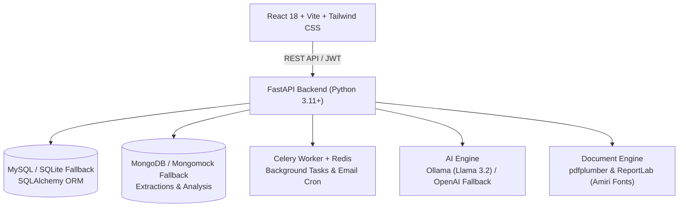

# Career Compass 🚀
> **AI-Powered Career Guidance, Resume Intelligence & Technical Interview Platform**  
> *Aligned with Technical Specification & Architecture Reference Guide v1.1*

[](https://fastapi.tiangolo.com/)
[](https://react.dev/)
[-black?style=flat)](https://ollama.ai/)
[](https://docs.celeryq.dev/)
[](https://docs.pytest.org/)

Career Compass is a full-stack, AI-driven career guidance and resume intelligence platform. Unlike traditional keyword-matching career tools, Career Compass integrates local Generative AI models (via **Ollama running Llama 3.2**, with cloud **OpenAI fallback**) to deeply analyze candidate resumes in Arabic and English, benchmark candidate skills against industry standards, generate personalized 3-month skill roadmaps, and conduct interactive technical mock interviews.

---

## ✨ Key Features & Capabilities

### 1. 📄 AI Resume Intelligence & LinkedIn Import
- **Multi-lingual PDF Parsing:** Extracts complex multi-column resumes in both English and Arabic using `pdfplumber` and local LLMs.
- **LinkedIn Profile Import:** Automatically detects exported LinkedIn PDF profiles and accurately extracts the **"Top Skills"** section and structured experience.
- **Manual Profile Fallback:** Full manual profile entry for users starting without a resume.

### 2. 🎯 Dynamic Recommendation Engine & 3-Month Roadmap
- **Weighted Skill Gap Analysis:** Algorithmic matching against industry roles using weighted categories (Essential: 1.0, Important: 0.6, Bonus: 0.3).
- **Interactive Roadmap Checklist:** Structured 3-month learning roadmap with milestones, interactive skill progress tracking, and curated learning courses.
- **Career DNA:** Multi-axis technical evaluation visualization (Programming, Data Handling, System Design, Communication, Problem Solving).

### 3. 🤖 Interactive Mock Interview Simulator & Voice AI
- **Hiring Manager AI Persona:** Dynamically interviews candidates on their specific target role and identified skill deficiencies.
- **Voice & Audio Interviews:** Real-time microphone audio recording (`MediaRecorder`), transcription (OpenAI Whisper), and speech metrics (Clarity, Pace/WPM, Vocal Confidence).
- **Structured 10-Point Scoring:** Evaluates completed sessions out of 10, categorizing Technical and Communication proficiency, identifying specific mistakes, and providing model answers.

### 4. 🔍 ATS Audit & In-Browser ATS Resume Builder
- **ATS Readability Score:** Comprehensive automated audit identifying formatting risks, section hierarchy issues, and missing industry keywords.
- **Full ATS Resume Builder & Exporter:** Interactive modal to refine profile details, optimize bullets via AI, and export an ATS-compliant resume PDF.
- **AI Cover Letter Generator:** One-click tailored cover letters for specific job descriptions.

### 5. 💼 Real-World Market Job Matching
- **Smart Synonym Matching:** Algorithmic candidate matching against active tech vacancies (Asal Technologies, Exalt, Harri, Foothill, Souktel, Progineer, Paltel, Canonical, Spotify, etc.).
- **Live Vacancy Details:** Displays exact match percentages, matched vs. missing skills, salary ranges, and direct application links.

### 6. 🏆 Gamification, Peer Benchmark & Arabic PDF Export
- **Gamification Badges:** Badges awarded based on milestones (e.g., Profile Pioneer, Roadmap Master).
- **Peer Cohort Benchmarking:** Anonymous percentile comparison against peer cohort runs.
- **Bidirectional Arabic PDF Export:** Branded, downloadable PDF reports with Arabic RTL support powered by `ReportLab` and bundled `Amiri` typography.
- **Public Report Sharing:** Secure tokenized links for public, unauthenticated viewing with revocation controls.

---

## 🛠️ Architecture & Tech Stack



| Layer | Technologies |
| :--- | :--- |
| **Frontend** | React 18, Vite, React Router v6, Tailwind CSS, Recharts, Axios, Lucide Icons |
| **Backend** | FastAPI, Python 3.11+, Pydantic v2, Uvicorn |
| **Relational DB** | MySQL 8.0 (Production) with automated SQLite fallback (Development/Testing) |
| **Document DB** | MongoDB (Production) with automated Mongomock fallback |
| **Task Queue** | Celery 5.3+, Redis 7.0+ (Scheduled email reminders, async PDF parsing) |
| **AI / LLMs** | Ollama (`llama3.2`), OpenAI (`gpt-3.5-turbo`, Whisper audio transcription) |
| **PDF Processing**| `pdfplumber` (text parsing), `reportlab` (bilingual RTL Arabic career report generation) |
| **Testing** | Pytest, TestClient, Mongomock, Unitest.mock (63 automated tests) |

---

## 🚀 Quick Start (Local Development)

### Prerequisites
- **Node.js** (v18+) & **npm**
- **Python** (3.11+)
- **Ollama** installed locally (optional, fallback heuristics included)

### Option A: One-Click Startup (Windows PowerShell)
Simply run the included `start.ps1` script from the repository root:
```powershell
.\start.ps1
```
This automatically initiates the Ollama AI model, starts the FastAPI backend (with SQLite and Mongomock fallbacks enabled for zero-dependency local runs), launches the Vite frontend server, and opens your browser at `http://localhost:5173`.

---

### Option B: Manual Step-by-Step Setup

#### 1. Setup Backend
```bash
cd backend
python -m venv myenv

# Windows:
.\myenv\Scripts\activate
# Linux/macOS:
source myenv/bin/activate

pip install -r requirements.txt
```

Run the backend server (uses local SQLite & Mongomock fallback if MySQL/Mongo are offline):
```bash
# Windows PowerShell:
$env:USE_SQLITE_FALLBACK="1"; $env:USE_MONGOMOCK="1"; python -m uvicorn app.main:app --reload --port 8000

# Linux / macOS:
USE_SQLITE_FALLBACK=1 USE_MONGOMOCK=1 python -m uvicorn app.main:app --reload --port 8000
```
Backend API will be running at: `http://localhost:8000` (Interactive Docs: `http://localhost:8000/docs`)

#### 2. Setup Frontend
In a new terminal:
```bash
cd frontend
npm install
npm run dev
```
Frontend will be running at: `http://localhost:5173`

#### 3. Run Celery Worker (Optional - for background jobs)
```bash
cd backend
celery -A app.celery_app worker --loglevel=info
```

---

## 🧪 Testing & Verification

The project includes an extensive test suite covering the full user journey, recommendation mathematics, LinkedIn extraction, mock interviews, and background tasks.

```bash
cd backend
pytest tests/ -v
```
**Results:** `63 passed, 100% test pass rate`.

---

## 🐳 Production Deployment (Docker Compose)

The repository provides production-ready Docker Compose configurations:

```bash
# 1. Build and launch all services (API, Frontend Nginx, MySQL, MongoDB, Redis, Celery)
docker compose -f docker-compose.prod.yml up -d --build

# 2. Seed initial catalogue data (Jobs, Skills, Questions)
docker compose exec backend python -c "from app.seed.seed_runner import run_seed; run_seed()"
```

---

## 📡 API Endpoints Overview

| Category | Method | Endpoint | Description |
| :--- | :--- | :--- | :--- |
| **Auth** | `POST` | `/register`, `/login` | Signup, login with JWT bearer tokens |
| **Auth** | `POST` | `/forgot-password`, `/reset-password` | Stateless password recovery via email |
| **Profile**| `GET`, `PUT` | `/profile` | Profile metadata, career goals & updates |
| **Profile**| `GET`, `DELETE`| `/profile/badges`, `/profile` | Earned achievement badges & account removal |
| **Settings**| `PUT` | `/settings/password`, `/benchmark-opt-in`, `/notifications` | Account security and preference toggles |
| **CV** | `POST` | `/upload-cv`, `/extract`, `/extract/async` | Synchronous and Celery asynchronous PDF extraction |
| **CV** | `POST` | `/extract/manual`, `/extract/confirm` | Manual profile specification and confirmation |
| **CV** | `GET`, `POST`| `/extract/{id}/ats-score`, `/cover-letter` | ATS readability audit & tailored AI cover letters |
| **CV Builder**| `POST` | `/extract/{id}/ats-builder/optimize`, `/export-ats-pdf` | AI resume builder & ATS-compliant PDF generation |
| **Assessment**| `GET`, `POST` | `/assessment` | Role-based technical quiz and proficiency scoring |
| **Analysis**| `POST` | `/analyze` | Recommendation engine & 3-month roadmap generation |
| **History**| `GET` | `/history`, `/history/{id}`, `/history/compare` | Past runs, side-by-side gap analysis |
| **Export** | `GET` | `/history/{id}/export/pdf` | Branded RTL Arabic & English PDF career report |
| **Roadmap**| `PATCH`| `/history/{id}/roadmap` | Interactive checklist milestone completion |
| **Shared** | `POST`, `GET`| `/history/{id}/share`, `/shared/{token}` | Public tokenized analysis report view |
| **Jobs** | `GET` | `/jobs/matched` | Active market vacancy matching with smart synonyms |
| **Interview**| `POST`| `/interview/start`, `/interview/chat` | Interactive AI technical mock interview session |
| **Interview**| `POST`| `/interview/{id}/voice`, `/interview/{id}/evaluate` | Whisper voice simulation & 10-point scoring |

---

## 📄 License
This project is licensed under the MIT License - see the `LICENSE` file for details.
